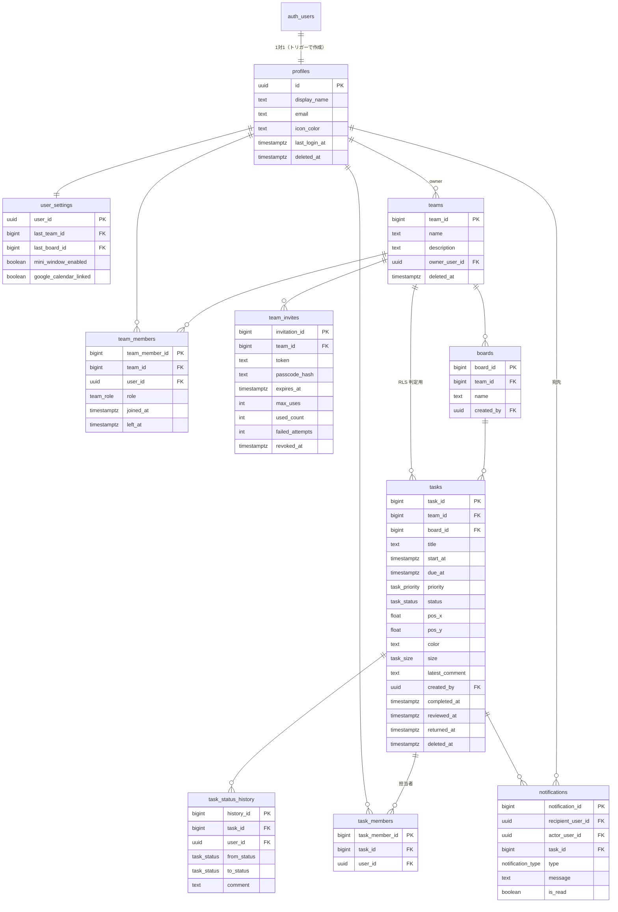

# 設計メモ（実装プロンプトからの確定事項と仮決定）

実装プロンプト（`設計/ClaudeCode用_実装プロンプト.md`）と、その後の質疑で決まった内容をまとめたものです。
**設計書（21〜27 の Excel）と矛盾する場合は、このファイルを優先**します。

- ✅ = 質疑で確定
- 🟡 = 仮決定（回答待ち。変更する場合はこのファイルとマイグレーションの両方を直す）

---

## 1. ディレクトリ構成

```
lib/
  main.dart                 # 起動（env が無ければ設定エラー画面）
  app/                      # 起動処理・ルーティング・テーマ・env
  core/
    errors/                 # 例外 → 日本語メッセージ変換
    platform/               # Windows / スマホ判定
    utils/                  # throttle など
  features/
    auth/ team/ board/ task/ invite/ notification/ calendar/ mini_window/ settings/
      data/                 # repository（Supabase とのやりとり）
      domain/               # model（freezed）
      presentation/         # 画面・provider
supabase/
  config.toml
  migrations/               # DB の変更は必ずここに SQL で追加する
  seed.sql                  # ローカル開発用データ
  tests/database/           # pgTAP（supabase test db）
docs/design.md              # このファイル
env.example.json            # env.json のひな形（env.json はコミットしない）
package.json                # Supabase CLI のバージョン固定用
```

## 2. ER 図



## 3. 権限（RLS ＋ 列単位 GRANT ＋ RPC）

権限は「UI で非表示」と「DB 側」の両方で守ります。DB 側は次の 3 段構えです。

1. **RLS**：どの行を見られる・変えられるか
2. **列単位 GRANT**：どの列をクライアントから直接書けるか（`deleted_at`・`completed_at` などは書けない）
3. **RPC（security definer）**：削除・完了・承認・招待など、権限チェックが複雑な処理

| テーブル | SELECT | INSERT | UPDATE | DELETE |
|---|---|---|---|---|
| profiles | 自分＋今のチームに（過去も含めて）いた人 | トリガー | 自分（表示名・色・最終ログイン） | × |
| user_settings | 自分 | 自分 | 自分 | × |
| teams | メンバー | RPC `create_team` | owner（名前・説明） | RPC `delete_team`（論理削除） |
| team_members | 同じチーム | RPC | RPC | × |
| team_invites | × | × | × | ×（RPC のみ） |
| boards | メンバー | leader | leader（名前） | × |
| tasks | メンバー | メンバー（作成者＝自分） | **操作できる人**（下記） | RPC `delete_task`（論理削除） |
| task_members | メンバー | 操作できる人 | — | 操作できる人 |
| task_status_history | メンバー | トリガー | × | × |
| notifications | 自分宛て | トリガー／RPC | 自分宛ての `is_read` | × |

**操作できる人**（`private.can_edit_task`）🟡：
- リーダー
- そのタスクの担当者
- 担当者が1人もいないタスクでは、作成者も操作できる

**削除・ゴミ箱からの復元**（`private.can_delete_task`）🟡：
- リーダー、または「作成者で、かつ操作できる人」

**ステータス**：
- `todo ⇔ in_progress` は、クライアントから直接 UPDATE できる。
- `done` にする／`done` から戻すのは RPC だけ（`complete_task` / `undo_complete` / `review_task` / `restore_completed_task`）。

## 4. 決定事項の一覧

### 確定 ✅
| 項目 | 内容 |
|---|---|
| A1 ミニウィンドウ | 1つのウィンドウを「管理モード ⇔ ミニモード」で切り替える（案①） |
| A2 招待の失敗 | `join_team` のエラーは例外ではなく戻り値 `{ok:false, code}` で返す |
| A3 パスコード | 参加には URL（token）とパスコードの両方が必要。パスコードの重複チェックはしない |
| A4 クラウドDB | リセットしてよい（`supabase db push` 前に既存テーブルを消す） |
| A5 対象 | Windows のみ（macOS / Linux フォルダは削除）。スマホは閲覧専用アプリを別に作る |
| B2 ボード | 列（未着手/進行中/完了）を廃止し、画面イメージどおりの自由配置キャンバスにする |
| B3 / B4 | `returned_at` で差し戻し中を判定。完了から戻ったら `reviewed_at` をクリア |
| B5 | Undo しても完了通知は消さない（届いたまま） |
| B6 | Undo で戻すステータスは履歴から取る |
| B7 | 承認・差し戻しの通知は「タスクを完了した人」へ |
| B8 | 開始・締切は時刻まで持てる（`start_at` / `due_at` は timestamptz） |
| B9 | 完了ログから復元すると完了・承認情報をクリアして todo に戻す |
| B13 | owner は退出できない |
| B17 | ログイン状態保持はログイン画面のチェックボックスにする（P0-05 と `skip_keep_login_prompt` は廃止） |
| B18 | メール変更は auth.users のトリガーで profiles に同期する |
| C3 | Realtime で task_members が変わったら、該当タスクを取り直す |
| C5 | 配布は「exe＋インストーラー」と「zip」の両方 |
| D2 | パッケージは完全固定 |

### 仮決定 🟡（回答待ち）
| 項目 | 仮決定の内容 | 理由 |
|---|---|---|
| E1 スマホ | 同じ Flutter プロジェクトで作る。通知の既読化だけ可能。新規登録・参加は PC のみ。プッシュ通知なし（アプリを開いたときに一覧表示）。Android 先行。フェーズ12の後。Web 版はなし | Edge Functions を使わず、Mac がなくても進められるため |
| E2 ボード | `board_columns` は作らない。ボード切替は「チーム」メニューの中に入れる。検索はヘッダーに 🔍 を追加。キャンバスは固定サイズでスクロール（座標は論理 px）。マイタスクはチーム内の全ボードが対象。カレンダーは左のボード領域だけを切り替える。完了したらボードから消えて「完」（完了ログ）へ。承認は完了ログと付箋詳細から | 列がないと board_columns に使い道がないため |
| E3 権限 | §3 の「操作できる人」のとおり | 「管理者と担当者以外は操作できない」を、担当者なしのタスクでも誰かが操作できるように補った |
| F1 時刻 | 時刻は省略可。省略時は `*_has_time = false` で、その日の 23:59（日本時間）として保存 | |
| F4 owner | owner のロールは変更不可。owner の譲渡機能は作らない。チームを離れるには削除のみ | |
| F5 ×ボタン | ミニウィンドウ ON なら×でミニモードに縮む。OFF ならタスクトレイへ隠れる。戻るときは元の位置・サイズ | |
| F6 配布 | Inno Setup でインストーラーを作る。署名なし（SmartScreen の警告は許容）。自動更新なし | |
| 設定画面 | P1-09 の追加項目は未受領。受け取りしだい反映 | |

## 5. 実装の状況

| フェーズ | 状況 | 主なファイル |
|---|---|---|
| 0〜1 | ✅ | `supabase/migrations/`, `supabase/tests/` |
| 2 認証 | ✅ | `lib/features/auth/` |
| 3 チーム・ボード | ✅ | `lib/features/team/` |
| 4〜5 付箋・D&D・同期 | ✅ | `lib/features/board/`, `lib/features/task/` |
| 6 ゴミ箱・メッセージ・アイコン | ✅ | `task/presentation/trash_page.dart`, `task_detail_dialog.dart` |
| 7 前回復元・プロフィール | ✅ | `team/presentation/home_resolver_page.dart`, `settings/` |
| 8 招待 | ✅ | `invite/`, `team/presentation/team_dialogs.dart` |
| 9 メンバー | ✅ | `team/presentation/team_manage_page.dart` |
| 10 通知・レビュー | ✅ | `notification/`, `task_detail_dialog.dart` |
| 11 ミニウィンドウ・トレイ | ✅ | `mini_window/` |
| 12 見た目・カレンダー | ✅ | `board/presentation/widgets/sticky_note.dart`, `calendar/` |
| 13 Googleカレンダー | ⏸ 未着手（着手前に相談） | — |
| スマホ版（閲覧専用） | ✅（仮決定 E1） | `mobile/` |

### 実装中に追加で決めたこと 🟡
| 項目 | 内容 | 理由 |
|---|---|---|
| user_settings の保存 | upsert ではなく update | 行は登録時にトリガーで作られる。upsert だと user_id 列の UPDATE 権限が必要になり、列単位 GRANT で拒否されるため |
| 担当者の付け替え | 「追加 → 削除」の順で実行 | 担当者が自分を外すとき、先に消すと操作権限がなくなり追加できないため |
| ログイン状態保持の初期値 | 保持する（ON） | 毎回ログインする手間を減らすため |
| 付箋のサイズ | S=140px / M=170px / L=210px（高さは幅の0.85倍） | |
| ミニモードの見た目 | 不透明度 95%、タスクバー非表示、上部をドラッグで移動、幅40pxに折りたたみ | |
| URL スキームの登録 | アプリ起動時に HKCU に登録（インストーラーでも登録） | zip 版でも招待URLを開けるように |
| 通知の取りこぼし | 起動時と Realtime 再接続時に通知を取り直す | 7.4 の 5 |

## 6. 注意点（開発メンバー向け）

- **新しいテーブルを作ったら**：RLS を有効化し、`revoke all ... from anon, authenticated` → 必要な分だけ `grant`（Supabase が自動で全権限を付けるため）。
- **新しい RPC を作ったら**：`revoke execute ... from public, anon` → `grant execute ... to authenticated`。
- **Realtime の DELETE イベント**は RLS で絞り込まれず、主キーだけが全員に届く。物理 DELETE は task_members だけなので、「自分が読み込み済みの task_member_id」以外は無視すること。
- RPC のエラーコードを増やしたら `lib/core/errors/error_messages.dart` にも追加する。
